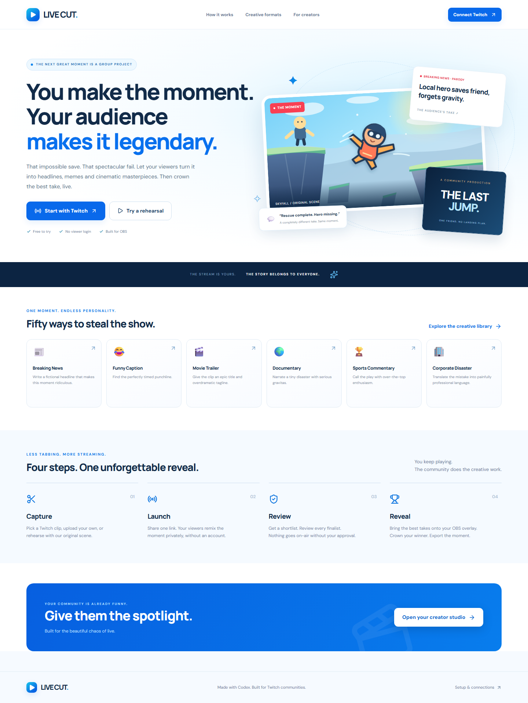
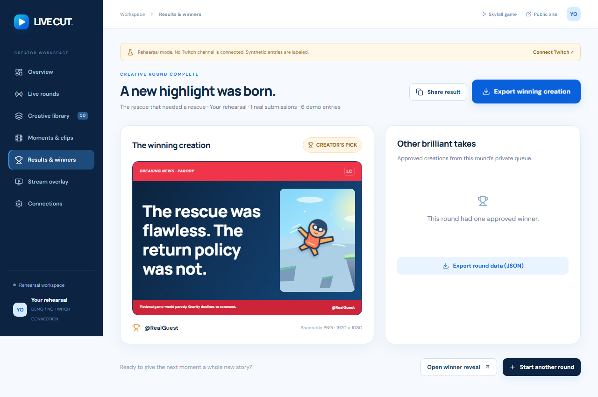

# LIVE CUT

**Your moment. Their imagination.** LIVE CUT turns a Twitch stream moment into an audience-powered creative competition. Viewers write headlines, captions, fictional memos, cinematic titles, and commentary. The creator reviews the entries, reveals finalists through an OBS browser source, and crowns the winner.



## The experience

**Capture → Launch → Review → Reveal.** Select a Twitch clip or upload your own MP4/WebM. Choose one creative format or Open Remix, set a submission window, and share the participation URL or QR code. Viewers enter a nickname, watch the moment, preview their creation, and submit privately without an account. After submissions close, review manually or request a Gemini shortlist. Approve, reveal, and crown are separate creator actions. Export the winning creation as a genuine 1920 × 1080 PNG and download the round as JSON.

- 50 schema-driven presets, five collections, six visual renderers.
- Server-side Twitch OAuth, stream status, asynchronous clip capture, and published clip selection.
- Persistent Cloudflare D1 entries and R2 video uploads; no browser-only database.
- Private submissions, guest-cookie and IP limits, exact duplicate protection, and human broadcast approval.
- Explicit Gemini review with structured output, bounded requests, and an honestly labeled rule-based fallback.
- Synchronized transparent OBS overlay and cinematic finalist/winner presentation.
- Responsive viewer studio, draft recovery, keyboard shortcut `Ctrl+Shift+C`, reduced-motion support.
- An original Skyfall illustration and playable mini game for rehearsal.



Screenshots show a real, automated rehearsal run. Rehearsal is visibly labeled and does not claim a Twitch connection. Synthetic entries are counted separately from entries submitted through the guest interface.

## Stack and layout

Next.js App Router conventions, TypeScript, React 19, Tailwind CSS, and Lucide run through [Vinext](https://github.com/cloudflare/vinext) on Cloudflare Workers. Vinext is a beta compatibility layer, not the standard Next.js production server. Drizzle manages D1 schema migrations. The official `@google/genai` SDK is server-only. Polling synchronizes round state every 2–5 seconds; no EventSub or chat service is required.

```text
app/                         Pages and the server API
components/                  Creator, viewer, renderer and broadcast interfaces
lib/domain.ts                Validation, duplicate normalization, state rules
lib/twitch.ts                OAuth, encrypted tokens, refresh and validation
lib/shortlist.ts             Gemini review and rule-based fallback
db/schema.ts + drizzle/      Persistent data schema and migrations
tests/                       Unit/security tests and Playwright journeys
```

## Install and run locally

Requires Node.js **22.13+**, npm, Git, and a modern browser. No paid account is required for rehearsal.

```bash
npm ci
npm run env:sync
npm run build
npm run db:migrate:local
npm run dev -- --port 5173 --hostname localhost
```

Open **http://localhost:5173**. Choose **Try a rehearsal** for a complete local workflow. The environment helper creates ignored `.env.local` with a random session secret and copies allowed values into ignored `.dev.vars`, which Wrangler reads. Re-run `npm run env:sync` and restart the server after editing secrets. Never commit either file. The local D1/R2 state lives in ignored `.wrangler/state` and survives server restarts.

`npm start -- --port 5173` previews the production Worker locally after building. Local and hosted databases are separate. `npm run db:migrate:local` applies only migrations not yet applied by that command. Existing development databases initialized manually should run the standard Wrangler migration command after recording their existing migration, or use a new clean checkout for first setup.

## Environment

Copy the names from `.env.example`. All values are server-only; no secret uses a `NEXT_PUBLIC_` prefix.

| Variable                     | Purpose                                                                        |
| ---------------------------- | ------------------------------------------------------------------------------ |
| `APP_URL`                    | Exact local or deployed origin; used for OAuth and write-origin checks         |
| `TWITCH_CLIENT_ID`           | Twitch developer application ID                                                |
| `TWITCH_CLIENT_SECRET`       | Confidential application secret                                                |
| `SESSION_SECRET`             | Random string of at least 32 characters; AES-GCM token encryption key material |
| `GEMINI_API_KEY`             | Optional key from your verified free-tier Google project                       |
| `GEMINI_MODEL`               | Defaults to `gemini-3.1-flash-lite`                                            |
| `GEMINI_FREE_TIER_CONFIRMED` | Defaults to `false`; explicit free-tier confirmation before AI requests        |

Keep `SESSION_SECRET` stable across deployments. Rotating it requires reconnecting existing Twitch accounts. Creator sessions are opaque HTTP-only cookies with a seven-day lifetime; only their hashes are stored. HTTPS enables Secure cookies. Twitch access and refresh tokens are encrypted in D1, validated on connection and at least hourly during active use, and refreshed when expiring. Revoked authorization invalidates creator sessions.

## Twitch setup

1. Sign in at the [Twitch developer console](https://dev.twitch.tv/console/apps) and enable account 2FA.
2. Register a **Confidential** app, category **Website Integration**.
3. Add `http://localhost:5173/api/auth/twitch/callback` and your exact deployed HTTPS origin followed by `/api/auth/twitch/callback` as OAuth redirect URLs.
4. Generate a client secret. Fill the local environment or production runtime variables. Set `APP_URL` to the matching origin.
5. Click **Connect Twitch** and approve **`clips:edit`**, the only requested scope. Stream status and user information do not require additional scopes.

Start the Twitch stream yourself in OBS. **Capture live moment** checks stream status, requests a clip, then polls Get Clips for up to 60 seconds. A `202 Accepted` response alone is not treated as a published clip. Offline streams, disabled clipping, unsupported categories, token failures and rate limits surface errors. Existing Twitch clips and local MP4/WebM uploads provide fallbacks. Uploads are limited to 20 MB and their file signatures are checked.

Twitch embeds use the actual page hostname as their `parent`. On very small screens the clip opens on Twitch because its embedded player has a minimum supported size. Local uploaded video plays directly. Follow [app registration](https://dev.twitch.tv/docs/authentication/register-app), [authorization-code OAuth](https://dev.twitch.tv/docs/authentication/getting-tokens-oauth/#authorization-code-grant-flow), [token validation](https://dev.twitch.tv/docs/authentication/validate-tokens/), [Create Clip](https://dev.twitch.tv/docs/api/reference/#create-clip), and [embed documentation](https://dev.twitch.tv/docs/embed/video-and-clips/).

## Gemini and cost control

Create a key in [Google AI Studio](https://aistudio.google.com/api-keys) for a project **without paid billing enabled**. Fill `GEMINI_API_KEY`, verify your project tier and quotas, then set `GEMINI_FREE_TIER_CONFIRMED=true`. LIVE CUT cannot query your billing status and does not create a billing account or upgrade a project.

The default model is documented as free of charge for eligible free-tier input/output on the checked [pricing page](https://ai.google.dev/gemini-api/docs/pricing#gemini-3.1-flash-lite). Paid-tier pricing is $0.25/million text input tokens and $1.50/million output tokens; that pricing is informational, not permission to incur charges. Model availability and project-specific [rate limits](https://ai.google.dev/gemini-api/docs/rate-limits) can change.

AI runs only when the creator requests it after submissions close. One bounded request contains at most 250 entries, 120 headline characters and 200 detail characters per entry, plus 400 characters of creator-provided context. Output is capped at 10,000 tokens with a 30-second SDK timeout, structured JSON, strict response validation, and at most two requests per round. There are no automatic retries; the creator may explicitly use the second allowance. Requests are locked during processing. The response must cover every candidate and use supplied IDs. No tools, search grounding, video upload, or continuous stream analysis is used.

The assistant flags problematic or irrelevant entries, identifies similar ideas, and suggests up to five diverse finalists. It does not approve entries or choose a winner. Missing configuration, provider failures, invalid coverage, or malformed output leave a visible **rule-based / no AI** fallback. Human safety review remains required.

Free-tier processing may be used by Google to improve its products under its terms. Entries should contain no private information. The viewer interface warns against private details and all creation text is treated as untrusted data.

## Database and deployment

The tracked `.openai/hosting.json` binds **DB** (D1) and **BUCKET** (R2). Sites provisions these on deployment and applies schema migrations. Do not put credentials in this manifest. To change the schema:

```bash
npm run db:generate
npm run build
npm run db:migrate:local
```

Commit the generated SQL and Drizzle metadata. Never rewrite a migration already applied to a database. Outside Sites, deploy the built Worker with matching D1 and R2 bindings and apply the same migrations through your Cloudflare account. This repository does not deploy or enable billing when you run its build commands.

Hosting is intended for a hackathon-scale demonstration. Polling and request/database/storage limits depend on the hosting plan. Do not assume unlimited free resources. The deployed URL and live integration evidence should be checked before judging; the repository’s tests alone do not certify live Twitch or OBS operation.

## OBS and solo demo

1. Start OBS, connect your Twitch account, and stream the original Skyfall game at `/game` or your own permitted gameplay.
2. Connect Twitch in LIVE CUT. Capture/select a clip, create a round, and click **Launch**.
3. Open **Stream overlay**, choose that round, and copy its browser-source URL into OBS. Set **1920 × 1080**, **30 FPS**, above gameplay. Keep it active when hidden. The normal source is transparent; `?preview=1` adds an original scene background for preview only.
4. Open the viewer URL in a separate browser/private session, write a real creation, and submit. This is the same public interface the audience uses. No extra person is needed.
5. Optionally add six **clearly labeled synthetic demo entries** from the round manager. They never inflate the real-entry count.
6. Close, review, and optionally request Gemini shortlisting. Preview and approve safe finalists, reveal them, then crown the winner.
7. Export the PNG and round JSON. Record the actual Twitch broadcast, viewer flow and overlay alongside genuine Codex development/testing footage.

The overlay is a read-only public surface and needs no creator login in OBS. It shows only the round prompt and explicitly revealed/approved content. A public URL is not a private access-control token.

## Verification

```bash
npm run typecheck
npm run lint
npm test
npx playwright install chromium
# Keep the local development server on localhost:5173 in another terminal.
npm run test:e2e
npm run build
```

Tests cover preset/schema validity; hostile and oversized input; duplicate normalization; deterministic diversity; round transition rules; AES-GCM integrity; HTTP-only cookies; origin checks; OAuth success, state, denial, revocation and token refresh; and Gemini failures, invalid outputs and safe finalist selection. Browser tests use separate creator/guest sessions, verify private entries remain hidden after approval until reveal, check unauthorized mutations, pause/resume, PNG downloads, genuine WebM uploads, byte-range playback, offline reconnects, and responsive widths. OAuth and Gemini provider responses are mocked in unit tests. Real Twitch authorization, clip creation, streaming, Gemini inference and physical OBS capture require separate live evidence.

## Codex and hackathon

Codex implemented the product, translated the supplied blue design references into responsive interfaces, built the API and integrations, wrote security/domain/browser tests, debugged the workflow, and prepared documentation. Most development took place in the main session **`01a19d96-8ffb-7d52-a64a-2eba0f09f096`**, verified from the active thread environment. No fabricated development history or demo footage is used.

See [the solo recording script](docs/demo.md). The [official hackathon](https://twitchcon-codex.devpost.com/) requires a repository, description, Codex session ID, and a public YouTube demo under three minutes showing Twitch operation and Codex development. A prepared application or draft is not a submitted entry.

## Limits and next steps

Guest identity is unverified: cookies and IP limits discourage abuse but cannot establish unique humans. There is no production-grade bot challenge, distributed Twitch refresh lock, automatic media cleanup, user deletion UI, or claim of objective humor scoring. Entries and uploads persist until an operator removes them; use non-sensitive demonstration content. Uploaded videos are shared with anyone who has their opaque media URL. Expired session/rate records need operational retention cleanup for long-running deployments.

PNG exports render typography and, for the original scene, the supplied original artwork. Twitch and uploaded video are not burned into exported images; exports are creative text cards with attribution. Video export and clip trimming are future work. Twitch clipping depends on live channel settings and API restrictions. This app does not continuously analyze livestreams, select winners automatically, or claim that local tests prove production or device acceptance.

The original Skyfall illustration was supplied in the approved design pack. The mini game and application were authored for this build. Open-source dependencies retain their respective licenses; retained Sites runtime/vendor notices remain in the repository.
